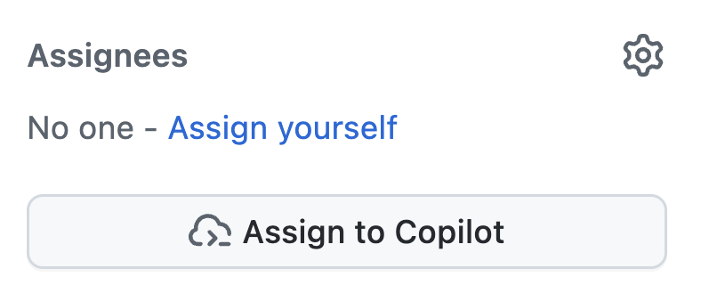

| [← 上一课：自定义指令][previous-lesson] |
|:--|

几乎所有组织都会遇到技术债务问题，例如未解决的安全问题、需要更新的旧代码，或因缺少时间而长期搁置的功能请求。GitHub Copilot 云智能体可以自主执行更新代码和添加功能等任务。任务完成后，它会创建草稿 PR，供开发人员审查。这样可以将繁琐任务交给智能体处理，加快开发进程，让开发人员专注于更重要的工作。

本课将介绍如何使用 Copilot 云智能体：

- 自定义代码生成环境。
- 确保安全地执行操作。
- 编写范围明确的议题。
- 将议题分配给 Copilot。

## 场景

Tailspin Toys 有一些技术债务需要处理。最初为网站开发的承包商没有留下完善的文档，事实上，网站完全缺少文档。团队希望首先为应用中的所有导出函数添加 TSDoc 文档注释。

此外，设计团队希望改进游戏发现功能。他们想在每款游戏的详细信息页面显示相关游戏（同类别的其他游戏），让用户可以继续浏览。他们目前不需要完善的实现，只需要一个用于用户体验探索和验收测试的初始版本。虽然这项工作目前受阻，但其他议题的优先级更高。

这类任务很容易被不断延后，正适合分配给 Copilot 云智能体。云智能体会在后台异步处理任务，开发人员可以继续处理其他工作，之后再回来审查 Copilot 的成果并确认其符合预期。

## 认识 GitHub Copilot 云智能体

[GitHub Copilot 云智能体](https://docs.github.com/copilot/concepts/agents/cloud-agent/about-cloud-agent#overview-of-copilot-cloud-agent-formerly-copilot-coding-agent)可以像开发人员一样在后台执行任务。就像与开发人员协作一样，你可以通过多种方式交办工作，例如[将 GitHub 议题分配给 Copilot](https://docs.github.com/copilot/how-tos/use-copilot-agents/cloud-agent/start-copilot-sessions)。分配任务后，Copilot 会创建草稿拉取请求以跟踪进度、设置环境并开始工作。会话进行期间或完成后，你都可以查看。Copilot 准备好让你审查建议的解决方案时，会在拉取请求中提及你。

## 编写范围明确的指令的重要性

GitHub Copilot 没有魔法，不能省去思考过程。即使看似简单的操作，深入分析后也会发现其复杂性，因此要[谨慎确定 Copilot 云智能体任务的范围][cloud-agent-best-practices]。将它视为 AI 结对编程助手：分阶段工作、学习、试验并不断调整。加入生成式 AI 并不会改变软件开发的基本原则。

## 本存储库中的自定义指令

前面的练习介绍了自定义指令及其作用。如果你已完成自定义指令实践，就见过 `.github/copilot-instructions.md` 的效果；如果还没有，现在可以快速查看。分配任务给 Copilot 云智能体前，先只读查看存储库中的指令文件，稍后便能观察它们的影响。

在 GitHub Web 界面或已启动的 codespace 中打开以下文件：

- `.github/copilot-instructions.md` — 查看 **Code standards** 部分，尤其留意 TypeScript 约定和 TSDoc 文档注释要求。
- `.github/instructions/unit-tests.instructions.md` — 留意 `applyTo` frontmatter，它将指令限定为 `**/*.test.ts` 文件。

在下一部分将 **Code lacks documentation** 议题分配给云智能体时，观察生成的拉取请求中是否包含 TSDoc 文档注释、TypeScript 约定和注释头。稍后的练习还会再次介绍这一点。

## 为 Copilot 云智能体设置开发环境

编写代码通常需要特定环境和一些设置脚本，以确保环境状态正常。将任务分配给 Copilot 也一样，因为它会像软件工程师一样工作。

云智能体使用 [GitHub Actions][github-actions] 执行任务。你可以通过专用设置工作流自定义环境：在 `.github/workflows/copilot-setup-steps.yml` 中配置[设置工作流][setup-workflow]，让它在云智能体开始工作前运行，以便安装所需的开发工具和依赖项。本实验已提前配置好设置，方便课程顺利进行并让你有机会了解此功能。设置步骤会安装 Node.js、项目依赖项、端到端测试所需的浏览器二进制文件，以及单体 Astro 应用所需的迁移和填充后的 SQLite 数据库：

```yaml
name: "Copilot Setup Steps"

# 允许你在存储库的 "Actions" 选项卡中测试设置步骤
on: workflow_dispatch

env:
  ASTRO_TELEMETRY_DISABLED: "1"

jobs:
  copilot-setup-steps:
    runs-on: ubuntu-latest
    # 将权限限制为 *你的步骤* 所需的最低权限。Copilot 会获得自己的令牌来执行操作。
    permissions:
      # 如果要在设置步骤中克隆存储库（例如安装依赖项），则需要 `contents: read` 权限。如果未在设置步骤中克隆存储库，Copilot 会在步骤完成后自动为你克隆。
      contents: read
    steps:
      - name: Checkout code
        uses: actions/checkout@v5

      # 前端/应用设置 - Node.js（整个应用现在基于 Astro + Drizzle/libSQL）
      - name: Set up Node.js
        uses: actions/setup-node@v6
        with:
          node-version: "lts/*"
          cache: "npm"
          cache-dependency-path: "./package-lock.json"

      - name: Install JavaScript dependencies
        run: npm ci

      - name: Install Playwright browsers
        run: npx playwright install --with-deps chromium

      # 迁移并填充本地 SQLite 数据库，为构建和测试提供数据。
      - name: Set up the database
        run: npm run db:setup
```

这与其他 GitHub 工作流文件类似，但有几个关键点：

- 其中只有一个名为 `copilot-setup-steps` 的作业。Copilot 开始处理拉取请求前，GitHub Actions 会运行此作业。
- 留意 `workflow_dispatch` 触发器。它允许你在存储库的 **Actions** 选项卡中手动运行工作流，以便测试工作流是否成功，而不必等待 Copilot 运行。

## 添加文档

所有人都知道文档很重要，但多数项目的文档要么已经过时，要么根本不存在。这类技术债务通常得不到处理，会降低效率，也增加维护代码库或让新开发者加入团队的难度。Copilot 擅长创建文档，因此这是分配给 Copilot 云智能体的理想任务。它会在后台生成所需文档，稍后的练习中你将回来审查其成果。

1. 在新的浏览器选项卡中前往 github.com 上的存储库。
2. 选择 **Issues** 选项卡。
3. 选择 **New issue**，打开新议题对话框。
4. 选择 **Blank issue**，创建新议题。
5. 将 **Title** 设置为 `Code lacks documentation`。
6. 将 **Description** 设置为：

    ```plaintext
    Our organization has a requirement that functions and methods include TSDoc doc comments where helpful. Unfortunately, recent updates haven't followed this standard. We need to update the existing code to ensure doc comments are included where they clarify behavior.
    ```

7. 选择 **Create** 创建议题。
8. 在右侧选择 **Assign to Copilot**，打开分配对话框。

  

9. 选择 **Assign**。
10. 选择 **Pull Requests** 选项卡。
11. 打开新生成的拉取请求（PR），其标题类似 `[WIP]: Code lacks documentation`。如果列表中没有出现新的 PR，请等待一两分钟，然后刷新浏览器窗口。
12. 几分钟后，你应该会看到 Copilot 创建的待办事项列表。

> [!NOTE]
> Copilot 可能需要几分钟才能在 PR 中创建待办事项列表。它需要创建环境（运行前面介绍的工作流）、分析项目并确定解决问题的最佳方法。

13. 查看待办事项及 Copilot 将要完成的任务。
14. 向下滚动拉取请求时间线，你应该会看到 Copilot 已开始处理议题的更新。
15. 选择 **View session** 按钮。

  

> [!CAUTION]
> 你可能需要刷新窗口才能看到状态指示器更新。

16. 浏览实时会话，了解 Copilot 如何解决问题，包括探索代码、了解当前状态、暂停思考并选择合适的计划，以及编写代码。

整个过程可能需要几分钟。Copilot 云智能体的主要目标之一是异步执行任务，让我们能专注于其他工作。接下来，我们会利用这一点：再分配一个任务给 Copilot 云智能体，同时开始为应用编写新功能。

## 为游戏详细信息页添加相关游戏部分

如前所述，GitHub Copilot 云智能体的一大优势是可以分工处理任务，让你专注于一组工作，而智能体处理另一组工作。为设计团队添加相关游戏部分可能不会花很长时间，但仍然会占用你处理其他工作的时间。现在就将此任务分配给 Copilot 云智能体！

1. 返回 github.com 上的存储库。
2. 选择 **Issues** 选项卡。
3. 选择 **New issue**，打开新议题对话框。
4. 选择 **Blank issue**，使用空白模板。
5. 将 **Title** 设置为 `Show related games on the game details page`。
6. 将 **Description** 设置为：

    ```markdown
    We want to help people discover more games by showing related games on each game's details page. The design team wants to explore the UX and do some acceptance testing. Our requirements are:

   - Add a data-access helper in `src/lib/` that returns other games in the same category as a given game, excluding that game
   - Show a "Related games" section on the game details page that uses the helper
   - Handle the case where a game has no related games
   - There should be unit tests created for the new helper
   - Before creating the PR, ensure all tests pass
    ```

7. 选择 **Create** 创建议题。
8. 在右侧选择 **Assign to Copilot**，打开分配对话框。

  

9. 选择 **Assign**。

不久后，你应该会在议题的第一条评论中看到 👀，表示 Copilot 已开始处理！


Copilot 正在处理你的第二个请求！Copilot 云智能体的工作方式与软件工程师类似，你不需要一直监控它；等待任务完成后再进行审查即可。接下来，我们来创建并使用自定义智能体。

## 总结和后续步骤

本课介绍了 [GitHub Copilot 云智能体][copilot-agents]。你可以将议题分配给云智能体，让它异步处理任务。你可以使用 Copilot 处理技术债务、创建新功能，或协助将代码从一种框架迁移到另一种框架。

本课介绍了以下概念：

- 自定义代码生成环境。
- 确保安全地执行操作。
- 编写范围明确的议题。
- 将议题分配给 Copilot。

云智能体正在后台处理任务，接下来我们将创建并使用自定义智能体。[Copilot 云智能体也可以使用 MCP 服务器][cloud-agent-mcp]，并且能够使用我们在前面的模块中介绍的自定义指令。

## 资源

- [关于 Copilot 云智能体][copilot-agents]
- [将 GitHub 议题分配给 Copilot][assign-issue]
- [Copilot 云智能体设置工作流最佳实践][cloud-agent-best-practices]

| [下一课：自定义智能体 →][next-lesson] |
|--:|

[previous-lesson]: ../1-custom-instructions/
[next-lesson]: ../3-custom-agents/
[cloud-agent-mcp]: https://docs.github.com/copilot/how-tos/copilot-on-github/customize-copilot/customize-cloud-agent/extend-cloud-agent-with-mcp
[assign-issue]: https://docs.github.com/copilot/how-tos/use-copilot-agents/cloud-agent/start-copilot-sessions
[setup-workflow]: https://docs.github.com/copilot/how-tos/copilot-on-github/customize-copilot/customize-cloud-agent/customize-the-agent-environment
[copilot-agents]: https://docs.github.com/copilot/concepts/agents/cloud-agent/about-cloud-agent
[cloud-agent-best-practices]: https://docs.github.com/copilot/how-tos/copilot-on-github/customize-copilot/customize-cloud-agent/customize-the-agent-environment
[github-actions]: https://docs.github.com/actions
